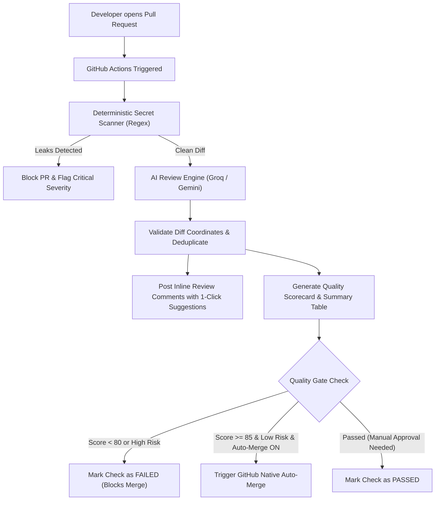

# 🛡️ PR Guardian — Automated AI Code Reviewer & Safe Auto-Merge Bot

> **100% Free-Tier Architecture:** Built with GitHub Actions, Groq API (`llama-3.3-70b-versatile`), and Google Gemini API (`gemini-2.0-flash`). No servers, no credit cards, zero hosting costs.

[](#)
[](#)
[](#)
[](#)

PR Guardian acts as an automated quality and security gate for your GitHub pull requests. It analyzes textual diffs, catches critical secret leaks deterministically, evaluates code quality with top-tier AI models, posts **1-click interactive code suggestions** directly on changed lines, and enables **safe auto-merge** when quality standards are satisfied.

---

## ✨ Key Features

| Feature | Description |
| :--- | :--- |
| **🤖 Dual Free AI Engines** | Supports **Groq** (`llama-3.3-70b-versatile` / `llama-3.1-8b-instant`) and **Google Gemini** (`gemini-2.0-flash` / `gemini-1.5-flash`) with automatic failover. |
| **🔑 Deterministic Secret Scanner** | Pre-AI regex shield that catches committed AWS keys, GitHub tokens, Slack keys, and private keys *before* AI review (zero tokens, 100% privacy). |
| **💡 One-Click Fix Suggestions** | Generates native GitHub ` ```suggestion ` blocks allowing developers to apply fixes directly from the PR UI with a single tap. |
| **📊 Quality Scorecard** | Evaluates PRs across 4 dimensions: **Security**, **Correctness**, **Maintainability**, and **Performance**. |
| **🧪 Test Gap Detection** | Recommends specific edge cases and test scenarios for newly introduced logic. |
| **📐 Repository-Aware Rules** | Enforces project-specific conventions loaded dynamically from `.github/review-guidelines.md`. |
| **🚦 Safe Auto-Merge Gate** | Optionally triggers GitHub native squash auto-merge only when the score is ≥ 85, risk is low, and zero blocking findings exist. |

---

## 🏗️ Architecture



---

## 🚀 Step-by-Step Setup Guide

### Step 1: Fork or Clone this Repository
If you haven't already:
```bash
git clone https://github.com/shyamsharmas124-commits/PR-Guardian.git
cd PR-Guardian
```

### Step 2: Get Free AI API Keys

You only need **one** of these keys, but adding both allows automatic fallback if one provider hits rate limits!

1. **Groq (Free & Ultra Fast):**
   - Go to [console.groq.com](https://console.groq.com)
   - Sign in and click **API Keys** → **Create API Key**
   - Copy your key (starts with `gsk_...`)
2. **Google Gemini (Free Generous Tier):**
   - Go to [aistudio.google.com](https://aistudio.google.com)
   - Sign in and click **Get API key** → **Create API key**
   - Copy your key (starts with `AIza...`)

### Step 3: Add GitHub Secrets & Variables

In your GitHub repository:
1. Navigate to **Settings** → **Secrets and variables** → **Actions**.
2. Under **Repository secrets**, click **New repository secret**:
   - Name: `GROQ_API_KEY` (paste your Groq key)
   - *(Optional)* Name: `GEMINI_API_KEY` (paste your Gemini key)
3. *(Optional)* Under **Variables**, click **New repository variable**:
   - `AI_PROVIDER`: `auto`, `groq`, or `gemini` (default: `auto`)
   - `GROQ_MODEL`: `llama-3.3-70b-versatile` (default)
   - `GEMINI_MODEL`: `gemini-2.0-flash` (default)
   - `MIN_PASSING_SCORE`: `80` (default)
   - `ENABLE_AUTO_MERGE`: `true` (enables automatic merging for qualifying PRs)

### Step 4: Configure Repository Auto-Merge (Optional)
If you wish to use auto-merge:
1. Go to **Settings** → **General** → scroll down to **Pull Requests**.
2. Check the box **Allow auto-merge**.
3. Under **Variables**, set `ENABLE_AUTO_MERGE=true`.

### Step 5: Test Locally

Test the deterministic secret scanner and AI prompt simulation locally without pushing to GitHub:

```powershell
# Set your key in your terminal session
$env:GROQ_API_KEY="your_groq_key_here"

# Run local test suite
python scripts/test_local.py
```

---

## 🧪 Verifying the Bot with a Test PR

1. Create a new branch:
   ```bash
   git checkout -b test-pr-guardian
   ```
2. Create a test file `calculator.py` with an intentional bug:
   ```python
   def is_eligible_to_vote(age: int) -> bool:
       # Bug: age 18 should be allowed to vote!
       return age > 18
   ```
3. Commit and push:
   ```bash
   git add calculator.py
   git commit -m "Add voting eligibility helper"
   git push -u origin test-pr-guardian
   ```
4. Open a Pull Request from `test-pr-guardian` into `main`.
5. Watch the **Actions** tab. PR Guardian will:
   - Analyze the diff
   - Post an overall scorecard review
   - Place an inline comment on `calculator.py` with an interactive `Commit suggestion` button!

---

## 🛡️ Quality Gate & Branch Protection

To make PR Guardian an enforced requirement for merges:
1. Go to **Settings** → **Branches** (or **Rulesets**).
2. Add a branch rule for `main`.
3. Check **Require status checks to pass before merging**.
4. Search for and select: `ai-review`.

Now, if a pull request introduces severe security vulnerabilities, secret leaks, or low-quality code, GitHub will block merging until the issues are resolved!

---

## 📁 Project Structure

```
├── .github/
│   ├── review-guidelines.md       # Custom rules & architecture conventions
│   └── workflows/
│       └── pr-guardian.yml        # GitHub Actions workflow trigger
├── scripts/
│   ├── review_pr.py               # Core AI review, secret scanner & merge logic
│   └── test_local.py              # CLI test tool for local testing
├── requirements.txt               # Lightweight dependencies (requests, groq)
└── README.md                      # Documentation
```

---

## ⚖️ License
MIT License. Free to use, adapt, and customize for your own open source and private repositories.
